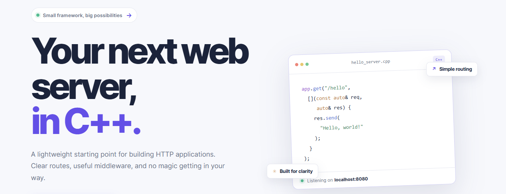

# HTTP Web Server

A lightweight HTTP server and web framework written in C++17.

The Linux-based server handles TCP connections and HTTP requests. Built on top
of it, the `web_core` framework provides routing, middleware, JSON responses,
and static-file serving—so you can build HTTP applications without writing
socket-handling code yourself.

This project is designed as a learning resource and includes a static website
example and REST API.

